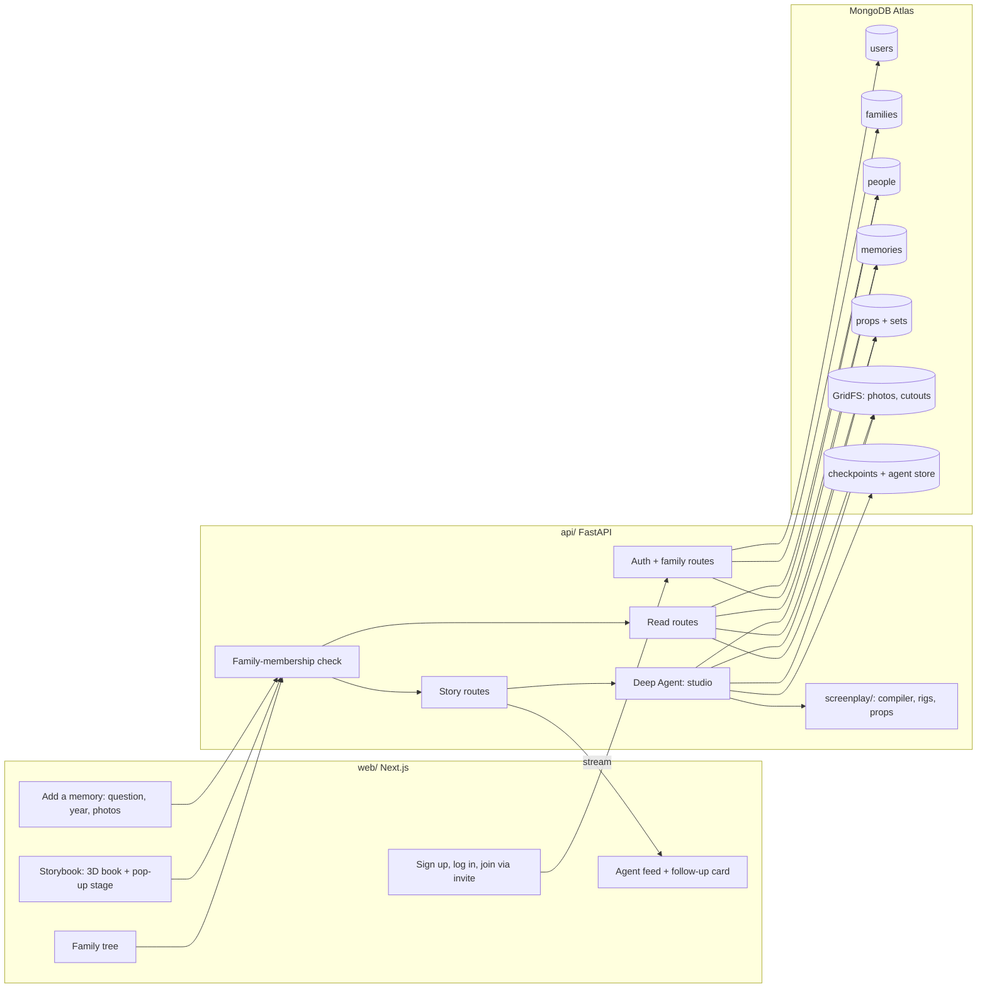

# Stitch architecture

Stitch is two apps in one repo:

- **`web/`** is a Next.js app that renders sign-up, the family tree, and the pop-up storybooks.
- **`api/`** is a FastAPI server that handles accounts and families, and hosts the Deep Agent, which turns a family member's answer and photos into an animated pop-up scene.

Everything is stored in MongoDB Atlas. Every family is private: all data belongs to one family, and only its members can read or write it.



There are two paths:

- **Writing** (adding a memory) goes through the agent.
- **Reading** (tree, books, compiled timelines) goes straight from the API to the database. Browsing stays fast and works even if the agent is busy or broken.

---

## 1. The storybook experience

### Book structure

- **Each person has a book.** Its spreads are their memories, in order by year. A memory with several participants appears in every participant's book, because it is stored once and referenced by each.
- **Each memory is one spread:**
  - **Left page (story):** title, year, the tellings in each teller's own words, and the original photos taped in like a scrapbook.
  - **Right page (stage):** a 3D pop-up set where the memory plays as a continuous animated scene, with paper puppets, props, a moving camera, and narration.
- **A memory is a sequence of shots,** usually 1 to 6 depending on the story. Shots don't cut. The current set folds flat into the page and the next one unfolds, while the camera keeps moving, so the whole memory plays as one take.

### The stage (three.js)

The whole book is a **react-three-fiber** (three.js) scene, not CSS layers.

- **Book and page flip.** The book is a 3D model. Each leaf is a segmented plane that bends as it turns, so the paper curls like a real page. Story pages are drawn to canvas textures.
- **Pop-up sets.** Every piece of scenery is a paper plane (a cutout texture with an alpha mask) placed in 3D at a depth. When a spread opens, the pieces rise from the fold on hinges. Back pieces rise first and stand tallest.
- **Camera.** After the set rises, the camera flies into the diorama. It follows the screenplay's camera track (wide, dolly to a target, pan, close-up) and pulls back out before the page turns. Pieces at different depths slide past each other as it moves (parallax), which is what makes it feel like film rather than slides.
- **Transitions.** Between shots, the set's pieces fold down and the next set's pieces unfold up, like a real pop-up mechanism, while the camera keeps moving.
- **Paper feel:**
  - Paper-grain normal maps and soft lighting, so the pieces catch the light.
  - Real shadows cast onto the page.
  - Deckled cut edges baked into each cutout's alpha mask.
  - A warm palette, a storybook serif for headings, a handwriting font for captions.
  - Optional page-turn and paper sounds.
- **Particles:** paper confetti, steam puffs, rain strips and smoke, all paper-style and generated in code.

> **Fallback:** if the 3D book eats too much time, use a CSS page flip (`react-pageflip`) with a three.js canvas on the right page only. The screenplay format and the stage do not change.

### Paper puppets (characters)

- **One shared rig.** Every person is the same rigged paper puppet: head, torso, upper and lower arms, hands, upper and lower legs. The parts are joined at pivots, like a split-pin paper doll. The rig is defined once in `shared/rig/puppet.json`.
- **Per-person look.** The character sheet sets the body color, height, build, and one signature item, such as dad's blue flat cap. The signature item is just a prop worn in the head socket (see props below).
- **No faces.** The puppets show emotion through body language only: head tilt, posture, walking speed, and how close they stand to someone.
- **Poses.** A pose library (`shared/rig/poses.json`) stores joint angles for stand, walk cycle, sit, kneel, wave, point, reach, hug, slumped, arms raised, and bow head.
- **Inverse kinematics.** Two-bone IK puts a hand on a target: a prop's grip point, another puppet's hand, or a door handle. Interactions like handing over a ring or a hug come from this.
- **Same figure everywhere.** A static render of the same puppet is the person's avatar on the family tree.

### Props

Props are actors with their own rig and state, not pictures in the background. **Nothing has to be hardcoded.** Any object a story mentions becomes a prop automatically.

**How a prop appears.** For each object in a story ("my dad's old trumpet case", "a bag of persimmons"):

1. **Extract.** The agent lists the object, a short description, who holds it, and a size class.
2. **Reuse if possible.** It checks the family's saved props first, then the small built-in library.
3. **Otherwise generate.**
   - An image model draws it in the locked cut-paper style, using the family's photos as reference when one shows the object.
   - Background removal turns it into a cutout.
4. **Auto-rig.**
   - **Anchor:** the bottom-center of the cutout's shape, computed by code.
   - **Grip:** the agent names where it's held ("the handle, on top"), and code snaps that point to the nearest edge of the shape.
   - **Scale:** taken from the size class, so a ring is always tiny and a car bigger than a person.
5. **Save** it to the family's `props` collection, so it looks the same in every later memory.

**Rig definition** (hand-written for library props, auto-generated for the rest):

```json
{
  "id": "green_sedan_1985",
  "familyId": "...",
  "source": "generated",
  "size": "vehicle",
  "art": { "body": "media/a1", "wheel": "media/a2" },
  "anchor": [0.5, 1.0],
  "grip": null,
  "sockets": { "driver": [0.35, 0.55], "passenger": [0.6, 0.55] },
  "parts": { "wheel_front": { "art": "wheel", "at": [0.22, 0.9], "spin": true },
             "wheel_back":  { "art": "wheel", "at": [0.8, 0.9],  "spin": true } },
  "states": { "parked": {}, "driving": {} }
}
```

- `size` is one of `tiny`, `hand`, `carried`, `furniture`, `vehicle`, `building`.
- `anchor` is where the prop meets the ground, and `grip` is where a hand holds it. Both are fractions of the prop's image.
- `sockets` are attachment points for a puppet or another prop: car seats, a chair seat, a tabletop.
- `parts` are separately moving pieces, and `states` are visual modes (open/closed, lit/out).

**Moving parts on generated props.** A generated prop is one flat cutout by default, and moves as a whole. Ways to give it parts:

| Approach | How | Use |
|---|---|---|
| **Flat** (default) | The whole prop moves as one piece | Most props |
| **Generated parts** | The agent asks for the body without the part, then the part on its own (car body, then a wheel). Code places the parts at the agent's coordinates. | Wheels, lids, doors |
| **States as images** | Generate a second image ("suitcase, open") and switch between them | Open/closed, lit/out |
| **Segmentation** (stretch) | A segmentation model cuts parts out of one image | Anything more complex |

**Built-in library (optional).** About 5 to 10 hand-rigged props, such as a car, chair, table, door and suitcase, in `shared/props/`. They appear instantly with no image call and have real moving parts, and they act as stand-ins on stage if generation fails. Everything else comes from the story text.

**Family review.** On the add-a-memory screen, the props the agent found show up as paper chips. The family member can swap one for a photo of the real thing, rename it, or remove it before the scene is built.

### Sets (scenery)

- A set is the scenery for one shot: a back, middle and front layer, each a paper cutout placed at a depth.
- The set designer describes each layer from the story and photos. The image model generates it in the locked style, and background removal cuts it out.
- Recurring places (the family house, grandma's kitchen) are saved to the family's `sets` collection and reused, just like props.

---

## 2. The agent (Deep Agents)

`create_deep_agent` runs one main agent (the "studio") with sub-agents that it delegates to through the built-in `task` tool. For each new memory, the agent first writes a plan (a to-do list), which streams to the UI.

```python
agent = create_deep_agent(
    model=MODEL,
    tools=[get_person, find_memories, save_memory, link_participants,
           describe_photo, find_prop, generate_prop, find_set, generate_set_layer,
           cut_out, compile_screenplay, render_frames, inspect_frames, synthesize_narration,
           ask_teller],
    system_prompt=STUDIO_PROMPT,
    subagents=[interviewer, storyboarder, prop_master, set_designer, director, narrator,
               checker, linker],
    skills=["agent/skills/popup-style", "agent/skills/storyboarding", "agent/skills/directing"],
    interrupt_on={"ask_teller": True, "merge_people": True, "confirm_props": True},
    checkpointer=MongoDBSaver(...),
    store=MongoDBStore(...),
)
```

### Sub-agents

| Sub-agent | Input | Output |
|---|---|---|
| **interviewer** | Answer, year | Decides whether the story can be staged. If it can't, calls `ask_teller` to pause and ask for the missing setting, people or action. |
| **storyboarder** | Full story | A shot list: which moments to show, where, in what order, with a source sentence for each |
| **prop_master** | Story, photos | The props: reuse saved or library props, generate the rest, auto-rig them. Pauses on `confirm_props` for the family's review. |
| **set_designer** | Shot list, photo descriptions | A set for each shot: reuses a saved place or generates back, middle and front layers |
| **director** | Shots, props, sets, cast | The **screenplay**: timed actions, camera tracks, and transitions |
| **narrator** | Screenplay, tellings | Narration lines, each tied to a source sentence, then text-to-speech with word timestamps |
| **checker** | Compiled timeline | Renders frames at key moments, critiques them with vision, sends fixes back to the director for at most 2 rounds. Rejects narration with invented details. |
| **linker** | Saved memory | Adds the memory to each participant's book and asks each of them for their version |

### The loop that makes it "deep"

```
storyboard → props + sets → director writes screenplay → compile
     ↑                                                       │
     └──── checker: render frames → vision critique ←────────┘
              (compile errors and visual problems go back to the director)
```

- **Compile errors** are exact and machine-readable, for example `shot 1, t=5: dad cannot hand_to "hymn_books"; mom is holding it`. The director fixes the screenplay and recompiles.
- **Visual problems** come from the checker's critique of rendered frames, for example "dad is hidden behind the bush at t=3" or "the books never reach mom".

### Decisions the agent makes (not a fixed chain)

- **New memory or a second telling?** A second telling of an existing memory gets added, and the agent re-directs the existing screenplay (a new shot, a different angle, a disagreement shown side by side) instead of making a new memory.
- **Follow up or proceed?** It decides whether the story has enough detail to stage.
- **Reuse or generate?** For each prop and place, it decides whether to reuse a saved one or make a new one.
- **How to show it?** It decides which moments become shots, and which details are left to the narration.
- **Merge people?** It asks before deciding that "Uncle Joe" is the Joseph already in the tree.

### Memory and files

- **Filesystem:** drafts like `shotlist.md`, `screenplay.json`, `compile_errors.txt`, `critique.md` and `open_questions.md` live in the agent's scratch filesystem.
- **Long-term memory:** `/memories/` is routed to `MongoDBStore`. It holds per-person notes (how each person moves: "grandpa walks slowly with a cane") and the family's style notes. Props and sets live in their own collections so the web app can read them.

---

## 3. The screenplay and timeline (the main contracts)

There are two formats:

- The **screenplay** is what the director writes: high-level and readable.
- The **timeline** is what the compiler outputs and the stage plays: explicit keyframes.

### Screenplay (written by the agent)

```json
{
  "memoryId": "...",
  "cast": ["dad", "mom"],
  "props": ["hymn_books", "green_sedan_1985"],
  "shots": [
    {
      "id": "s1",
      "set": "church_steps_1988",
      "marks": { "steps_left": [0.2, 0.0], "steps_top": [0.6, 0.3], "curb": [0.9, 0.0] },
      "start": { "dad": { "at": "offstage_left" }, "mom": { "at": "steps_top", "holding": "hymn_books" } },
      "camera": [
        { "t": 0, "move": "wide" },
        { "t": 4, "move": "dolly_to", "target": "mom", "dur": 3 }
      ],
      "actions": [
        { "t": 0,   "who": "dad", "do": "walk_to", "to": "steps_left" },
        { "t": 1.5, "who": "mom", "do": "drop", "what": "hymn_books" },
        { "t": 3,   "who": "dad", "do": "pick_up", "what": "hymn_books" },
        { "t": 5,   "who": "dad", "do": "hand_to", "what": "hymn_books", "to": "mom" },
        { "t": 6.5, "who": "mom", "do": "pose", "pose": "bow_head" }
      ],
      "narration": [
        { "t": 0, "text": "I saw her at the top of the church steps…", "source": "telling:dad:s2" },
        { "t": 1.5, "text": "…and then she dropped every single hymn book.", "source": "telling:dad:s3", "cue": "drop" }
      ],
      "transition": "fold"
    }
  ]
}
```

**Action vocabulary**

| Kind | Verbs |
|---|---|
| Movement | `walk_to`, `run_to`, `enter`, `exit`, `turn_to`, `follow` |
| Body | `pose` (any pose in the library), `wave`, `point_at`, `sit_on`, `stand_up`, `kneel`, `hug`, `lean_toward` |
| Props | `pick_up`, `hold`, `drop`, `hand_to`, `put_on`, `place_on`, `open`, `close`, `set_state` |
| Vehicles | `get_in`, `get_out`, `drive_to`, `ride_to` |
| Camera | `wide`, `dolly_to`, `pan_to`, `close_up`, `pull_back` |
| Effects | `confetti`, `steam`, `rain`, `smoke`, `time_of_day` |

Narration can carry a `cue`. The compiler then shifts the cued action to land on the word the narrator says ("dropped"), using the TTS word timestamps.

### The compiler (`api/screenplay/compiler.py`, no LLM calls)

Turns a screenplay into a timeline:

1. **Validate.** Every verb, mark, prop and person exists, and every action fits its kind (a `hug` needs two puppets, a `drive_to` needs someone in the driver socket).
2. **Track state.** Simulate each prop and puppet through time: where it is, who holds it, which socket it's in, its state. This rejects impossible actions ("hand_to: dad isn't holding hymn_books") and carries state between shots.
3. **Resolve motion.**
   - Marks become 3D positions on the set's ground.
   - Walks become paths with a walk-cycle at a speed based on the person's build and notes.
   - Reaches become two-bone IK solutions to grip points.
   - Vehicles move with their seated puppets, and wheels spin by the distance travelled.
4. **Attach.** Props held in a hand are parented to the hand bone, and puppets in a seat are parented to the socket.
5. **Time to narration.** Stretch or shift actions so cued actions land on their words. Narration that runs longer than the actions extends the shot.
6. **Output** the timeline, plus a list of errors for the agent if any step failed.

### Timeline (played by the stage)

```json
{
  "duration": 9.2,
  "audio": "media/n1",
  "tracks": [
    { "target": "puppet:dad", "channel": "root.position", "keys": [[0, [-1.2, 0, 0.4]], [2.1, [-0.4, 0, 0.4]]] },
    { "target": "puppet:dad", "channel": "arm_r.upper.rot", "keys": [[4.6, 0.1], [5.0, 1.2]] },
    { "target": "prop:hymn_books", "channel": "parent", "keys": [[1.5, "ground"], [3.2, "puppet:dad.hand_r"], [5.4, "puppet:mom.hand_l"]] },
    { "target": "camera", "channel": "pose", "keys": [[0, "wide"], [4, [0.6, 0.4, 1.1, "mom"]]] }
  ],
  "captions": [{ "t": 0, "text": "I saw her at the top of the church steps…" }]
}
```

- **The stage is a dumb player.** It interpolates keys, swaps parents, and plays audio. All the logic lives in the compiler, so the agent, the checker's rendered frames, and the browser always agree.
- **Rendering for the checker.** `render_frames` opens the web app's `/render/[memoryId]` route in headless Chromium (Playwright) and screenshots chosen times. The checker therefore sees exactly what the family will see.
- **Untrusted content.** Everything the model writes is data, never code or markup. Images come from the image model and pass through background removal. Text is rendered as text. The compiler rejects unknown fields.

## 4. Accounts and families

Nothing is hardcoded. Families build themselves:

1. **Sign up.** Each family member creates an account with an email and password. Passwords are hashed with argon2. The API sets a session JWT in an httpOnly, `SameSite=Lax` cookie, and the web app sends it along on every request.
2. **Start a family.** The first person creates a family ("The Maos"), becomes its admin, and adds themselves as the first person in the tree.
3. **Invite.** An admin shares an invite link (`/join/{code}`). The code is random, can be revoked, and expires after 14 days.
4. **Join and claim.** Someone who opens the link logs in or signs up, then either:
   - **claims** an existing person in the tree ("I'm David"), which sets `person.userId` to their account, or
   - **adds themselves** as a new person, picking their relationships (child of Rosa and Luis, married to Ana).
5. **People without accounts.** Any member can add relatives who will never sign up, such as late great-grandparents or young kids. They are full people in the tree with books of their own. Others tell stories about them, and anyone can claim them later.

### Users, people, and families

- **A user is a login, and a person is a node in a tree.** A user can be linked to one person in each family they belong to. A person can exist without a user.
- **One user, several families.** Spouses often belong to both sides. When a user switches families, they see a different tree.
- **Roles:**
  - **admin** can invite, remove members, and merge duplicate people.
  - **member** can add people, add memories, and edit their own tellings.
- **Duplicates:** if someone adds "Grandma Rosa" when she already exists, the agent's `merge_people` approval and the admin merge tool resolve it.

### Access control

- `auth.py` provides two FastAPI dependencies:
  - `current_user` decodes the session cookie.
  - `family_member(family_id)` checks that the user belongs to the family and returns their role.
- **Every family-scoped route** (tree, books, memories, media, agent runs) depends on `family_member`, and every query filters by `familyId`. Opening an id from another family returns 404, not 403.
- **The agent is scoped too.** It receives the family id when its run starts, and its database tools are bound to that family, so a prompt can never make it read another family's records.
- **Photos** are served through `GET /media/{id}` with the same check. They are never public URLs.

## 5. Data model (MongoDB Atlas)

**`users`**

```json
{ "_id": "...", "email": "david@example.com", "passwordHash": "$argon2id$...", "name": "David", "createdAt": "..." }
```

**`families`**

```json
{
  "_id": "...",
  "name": "The Maos",
  "members": [ { "userId": "...", "role": "admin", "joinedAt": "..." } ],
  "invites": [ { "code": "k3J9...", "createdBy": "...", "expiresAt": "...", "revoked": false } ]
}
```

**`people`**: every person belongs to one family. `userId` is `null` until someone claims them.

```json
{ "_id": "dad", "familyId": "...", "userId": "...", "name": "David", "born": 1962,
  "parentIds": ["grandpa", "grandma"], "spouseIds": ["mom"],
  "character": { "color": "#3f6fb5", "item": "blue flat cap", "build": "tall" },
  "addedBy": "..." }
```

Each new person gets a character sheet picked from an unused color and a signature item, and the family can change it.

**`memories`**: one per real-world event, shared across books.

```json
{
  "_id": "...",
  "familyId": "...",
  "title": "How I met your mother",
  "year": 1988,
  "participantIds": ["dad", "mom"],
  "tellings": [
    { "authorId": "dad", "question": "How did you meet your wife?",
      "text": "...", "photoIds": ["..."], "createdAt": "..." }
  ],
  "screenplay": { /* written by the agent, see section 3 */ },
  "timeline": { /* compiled, played by the stage */ },
  "propIds": ["hymn_books", "green_sedan_1985"],
  "version": 2,
  "embedding": [ /* for Vector Search */ ]
}
```

**`questions`**: pending prompts for a person, created by the linker.

```json
{ "familyId": "...", "personId": "mom", "text": "Dad says you met on the church steps. What do you remember?", "memoryId": "...", "status": "open" }
```

**`props`**: the family's saved props, with the rig definition shown in section 1. Library props live in `shared/props/` and are not stored per family.

**`sets`**: the family's saved places (the first house, grandma's kitchen). Each has its layers (cutout, depth, height) and named marks.

```json
{ "_id": "church_steps_1988", "familyId": "...", "name": "St. Mary's church steps",
  "layers": [ { "art": "media/b1", "depth": 0, "height": 1.0 }, { "art": "media/b2", "depth": 1, "height": 0.7 } ],
  "marks": { "steps_left": [0.2, 0.0], "steps_top": [0.6, 0.3] } }
```

**GridFS:** uploaded photos, generated cutout PNGs, and narration audio, with `familyId` in each file's metadata, referenced by id from tellings and layers.

**Indexes:**

- `users.email`: unique
- `families.members.userId`
- `families.invites.code`: unique
- `people`: `(familyId, userId)` and `(familyId, parentIds)`
- `memories`: `(familyId, participantIds, year)`
- `props`, `sets`: `(familyId, name)`, plus a vector index on the description for matching "the old trumpet case" to a saved prop
- Vector index on `memories.embedding`, filtered by `familyId`

**LangGraph collections:** `MongoDBSaver` stores checkpoints, so runs can pause for follow-ups and resume. `MongoDBStore` holds the agent's long-term memory.

**Queries used:**

- **Tree:** `$graphLookup` over `parentIds`, restricted to `{ familyId }`, starting from the oldest ancestors.
- **A person's book:** `memories.find({ familyId, participantIds: id }).sort({ year: 1 })`
- **"Ask the family":** keyword search merged with Atlas Vector Search over `memories.embedding` (a `familyId` pre-filter), ranked with the people the question names (kinship words resolved for whoever asks), returning quotes from the tellings and the single best memory to open. When `ANTHROPIC_API_KEY` is set, a small Claude model (`asking.py`, `STITCH_ASK_MODEL`) picks among the top candidates and writes a short answer from the quotes; any failure falls back to the search result.

## 6. API routes

**Accounts and families**

| Route | Purpose |
|---|---|
| `POST /auth/signup` | Create an account and set the session cookie |
| `POST /auth/login` / `POST /auth/logout` | Start or end a session |
| `GET /me` | The current user and the families they belong to |
| `POST /families` | Create a family. The caller becomes admin and its first person. |
| `POST /families/{fid}/invites` | Admin: create an invite link |
| `DELETE /families/{fid}/invites/{code}` | Admin: revoke an invite |
| `GET /invites/{code}` | Preview an invite: family name and unclaimed people |
| `POST /invites/{code}/join` | Join, then claim a person (`personId`) or add a new one (name and relationships) |
| `POST /families/{fid}/people` | Add a relative, with or without an account |
| `PATCH /families/{fid}/people/{id}` | Edit a person, relationships, or character sheet |
| `DELETE /families/{fid}/members/{userId}` | Admin: remove a member |

**Family content** (every route checks family membership)

| Route | Purpose |
|---|---|
| `GET /families/{fid}/tree` | People and relationships for the home page |
| `GET /families/{fid}/people/{id}/book` | That person's memories, ordered by year, with spreads |
| `GET /families/{fid}/memories/{id}` | One memory with all its tellings and spreads |
| `GET /families/{fid}/media/{id}` | Photo, cutout, or narration audio from GridFS |
| `GET /families/{fid}/props`, `GET /families/{fid}/sets` | The family's saved props and places |
| `PATCH /families/{fid}/props/{id}` | Rename a prop, or replace its art with a photo |
| `POST /families/{fid}/memories` | Submit question, answer, year, and photos. The author is the caller's person. Starts an agent run and returns a `runId`. |
| `GET /families/{fid}/runs/{id}/stream` | Server-sent events: `plan`, `subagent_start`, `subagent_end`, `question` (needs input), `props_found` (needs review), `compile_error`, `frames` (checker screenshots), `scene_ready`, `done`, `error` |
| `POST /families/{fid}/runs/{id}/answer` | Answer a follow-up question, confirm or edit the props, or approve a merge. Resumes the same thread. |
| `GET /families/{fid}/questions` | Pending prompts for the caller's person |
| `POST /families/{fid}/ask` | "Ask the family" search |

Each memory submission gets its own agent thread, so a follow-up resumes the same run. Only the user who started a run can answer its follow-ups.

## 7. Repo layout

```
stitch/
├── shared/                             read by both api/ and web/
│   ├── rig/
│   │   ├── puppet.json                 bones, lengths, pivots, sockets
│   │   └── poses.json                  joint angles per pose, walk cycle
│   ├── props/                          optional built-in props: art + rig JSON
│   └── vocabulary.json                 allowed verbs, camera moves, effects
├── web/                                Next.js (TypeScript)
│   ├── app/
│   │   ├── page.tsx                    home: family tree
│   │   ├── (auth)/login/, signup/      account pages
│   │   ├── families/new/               start a family
│   │   ├── families/[familyId]/settings/  members, invite link, roles
│   │   ├── join/[code]/                accept an invite, claim or add your person
│   │   ├── people/[id]/page.tsx        that person's storybook
│   │   ├── memories/[id]/page.tsx      a single memory opened as a book
│   │   ├── render/[memoryId]/page.tsx  bare stage for headless frame capture (checker)
│   │   └── add/page.tsx                question, year, photos, prop review, live agent feed
│   ├── components/
│   │   ├── tree/
│   │   │   └── FamilyTree.tsx          puppet avatars on a drawn tree
│   │   ├── book/
│   │   │   ├── Book3D.tsx              three.js book, spine, leaf stack, navigation
│   │   │   ├── Leaf.tsx                bending page mesh for the flip
│   │   │   └── StoryPage.tsx           left page texture: tellings, year, taped photos
│   │   ├── stage/
│   │   │   ├── Stage.tsx               plays a timeline: sets, puppets, props, camera, audio
│   │   │   ├── SetPiece.tsx            hinged paper layer that rises and folds
│   │   │   ├── Puppet.tsx              rigged paper puppet from a character sheet
│   │   │   ├── PropActor.tsx           prop with parts, states, and sockets
│   │   │   ├── CameraRig.tsx           camera track playback
│   │   │   ├── Effects.tsx             paper confetti, steam, rain, smoke
│   │   │   └── timeline.ts             key interpolation and parent swaps
│   │   ├── paper/
│   │   │   ├── materials.ts            paper grain, normal maps, deckled alpha
│   │   │   └── Tape.tsx, Photo.tsx     scrapbook details
│   │   └── agent/
│   │       ├── AgentFeed.tsx           live plan, sub-agent steps, checker frames
│   │       ├── PropChips.tsx           review the props the agent found
│   │       └── FollowUpCard.tsx        answer the agent's question
│   ├── lib/
│   │   ├── api.ts
│   │   └── types.ts                    Person, Memory, Prop, Set, Screenplay, Timeline
│   └── public/
│       ├── samples/                    hand-written screenplays and timelines for frontend work
│       └── textures/                   paper grain, tape
├── api/                                FastAPI (Python)
│   ├── main.py
│   ├── pyproject.toml                  uv project
│   ├── auth.py                         password hashing, session JWT, current_user, family_member
│   ├── schemas.py                      Pydantic models; mirrors web/lib/types.ts
│   ├── routes/
│   │   ├── auth.py                     signup, login, logout, me
│   │   ├── families.py                 create family, invites, join and claim, people
│   │   ├── tree.py                     tree, books, memories, media reads
│   │   ├── props.py                    saved props and sets
│   │   ├── memories.py                 submit, stream, answer
│   │   └── ask.py
│   ├── db/
│   │   ├── client.py                   Atlas connection, indexes
│   │   ├── users.py
│   │   ├── families.py                 memberships, invites
│   │   ├── people.py                   $graphLookup tree
│   │   ├── memories.py
│   │   ├── props.py                    props and sets, vector match on descriptions
│   │   ├── media.py                    GridFS
│   │   └── search.py                   Vector Search
│   ├── agent/
│   │   ├── studio.py                   create_deep_agent setup
│   │   ├── subagents.py
│   │   ├── tools/
│   │   │   ├── family.py               get_person, find_memories, save_memory, link_participants
│   │   │   ├── photos.py               describe_photo (vision)
│   │   │   ├── props.py                find_prop, generate_prop, confirm_props
│   │   │   ├── sets.py                 find_set, generate_set_layer
│   │   │   ├── art.py                  image model calls, cut_out (background removal)
│   │   │   ├── compile.py              compile_screenplay (wraps screenplay/compiler.py)
│   │   │   ├── frames.py               render_frames (Playwright), inspect_frames (vision)
│   │   │   ├── narration.py            synthesize_narration (TTS + word timestamps)
│   │   │   └── ask.py                  ask_teller (interrupt)
│   │   ├── prompts/
│   │   └── skills/
│   │       ├── popup-style/            cut-paper rules, palette, style prompt, reference image
│   │       ├── storyboarding/          choosing moments, shot lists
│   │       └── directing/              the action vocabulary and how to stage scenes
│   ├── screenplay/                     no LLM calls in here
│   │   ├── schema.py                   screenplay and timeline models
│   │   ├── state.py                    prop and puppet state simulation
│   │   ├── ik.py                       two-bone IK
│   │   ├── motion.py                   paths, walk cycles, vehicles, camera tracks
│   │   ├── compiler.py                 screenplay → timeline + errors
│   │   └── autorig.py                  anchor and grip from a cutout's alpha mask
│   ├── seed/                           demo family (accounts, photos, memories) for the stage demo
│   └── tests/                          compiler tests: valid scenes, impossible actions
├── .env.example
├── README.md
└── ARCHITECTURE.md
```

**Rules that keep it clean**

- Routes only handle requests. Read routes never import `agent/`.
- Only `db/` talks to MongoDB, and every `db/` function that reads family data takes `family_id` as a required argument. The agent reaches the database through `agent/tools/family.py`, which is bound to the run's family.
- Every family-scoped route depends on `family_member`. A route without it is a bug.
- `screenplay/` is plain, tested code with no LLM calls. The stage never makes decisions; it only plays the compiled timeline.
- `shared/` is the single source for the rig, poses, library props, and vocabulary. The compiler, the agent's directing skill, and the stage all read it.
- The art style lives in `skills/popup-style/`. Changing the look means editing text, not code.

## 8. Build order

1. **Contracts.** `schemas.py`, `types.ts`, `shared/rig/*`, `shared/vocabulary.json`, and the hymn-book scene written by hand as both a screenplay and a timeline in `public/samples/`.
2. **The stage (highest risk).** `Stage`, `Puppet`, `PropActor`, `SetPiece` and `CameraRig` playing the hand-written timeline in three.js, with placeholder art. **Decision point Saturday morning:** if puppets and camera look good, commit. If not, drop to the simpler layered version (sets rise, puppets slide, no IK) using the same formats.
3. **The compiler.** State simulation, marks, walk paths, IK, then narration timing. Test it against the hand-written screenplay until it reproduces the hand-written timeline.
4. **The book.** `Book3D` and `Leaf` page flip around the stage, and `StoryPage`.
5. **Data.** Atlas setup, indexes, seed family, tree and book routes.
6. **Accounts and families.** Sign-up, login, create family, invite link, join and claim. Keep the UI plain.
7. **Agent, core path.** Storyboarder, director, compile with the error loop, save. Uses library props and placeholder sets.
8. **Generated art.** Prop master and set designer with image generation, cutouts and auto-rig. Then the prop chips review.
9. **Narration and the checker.** TTS with word timestamps and cues, then Playwright frames and the vision critique loop.
10. **Agent extras.** Interviewer follow-ups, the linker, second tellings, and "ask the family".
11. **Polish and a backup demo recording.**

## 9. Team split (4 people)

| Owner | Area |
|---|---|
| Stage | `components/stage`, `components/book`, `components/paper`: three.js, puppets, props, camera, page flip |
| Pages | Tree, sign-up, join, and add-a-memory flows, agent feed, `lib/` |
| Agent + compiler | `api/agent`, `api/screenplay`, `shared/` |
| Data | `api/db`, `api/routes`, `api/auth.py`, seed family and photos, Atlas Vector Search |

## 10. Risks

| Risk | Mitigation |
|---|---|
| Puppets and camera don't look good in time | Build the stage first against a hand-written timeline. Fallback is layered sets with sliding puppets (no IK). Same formats. |
| 3D page flip eats the weekend | CSS flip with `react-pageflip` and a three.js canvas on the right page only |
| The director writes screenplays that don't compile | Exact compile errors fed back to the agent, a tight vocabulary in the directing skill, and few-shot examples |
| Generated props are the wrong scale or have bad grips | Size classes set scale. The checker's frames catch bad grips, and the family can swap a prop for a photo. |
| Generated scenery and props look inconsistent | Locked style prompt and reference image, tested on the first night. Library props as stand-ins. |
| Agent run is slow (1 to 3 minutes with generation and checking) | Stream the plan, steps and checker frames into the feed; generate props and sets in parallel; pre-generate the seeded family. |
| Live demo fails | Seeded memories are already rendered, and there's a recorded backup video. |
| Accounts eat the weekend | Plain email and password only (no OAuth or email verification), simple forms, and seeded demo accounts for the stage. |
| One family's data leaks into another | `family_member` on every route, `familyId` required in every `db/` call, agent tools bound to one family, plus a test that requests another family's ids and expects 404. |
