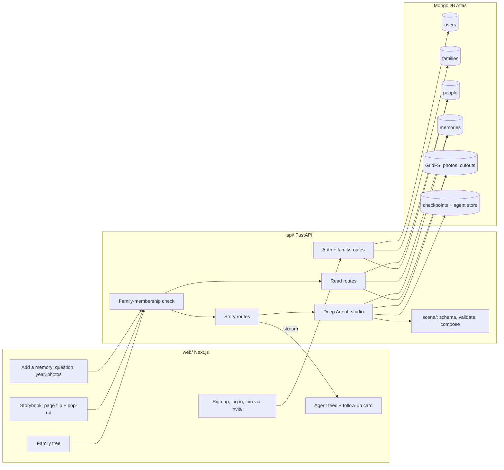

# Stitch architecture

Stitch is two apps in one repo:

- **`web/`** is a Next.js app that renders sign-up, the family tree, and the pop-up storybooks.
- **`api/`** is a FastAPI server that handles accounts and families, and hosts the Deep Agent, which turns a family member's answer and photos into pop-up spreads.

Everything is stored in MongoDB Atlas. Every family is private: all data belongs to one family, and only its members can read or write it.



There are two paths:

- **Writing** (adding a memory) goes through the agent.
- **Reading** (tree, books, spreads) goes straight from the API to the database. Browsing stays fast and works even if the agent is busy or broken.

---

## 1. The storybook experience

### Book structure

- **Each person has a book.** Its spreads are their memories, in order by year. A memory with several participants appears in all of their books, because it is stored once and referenced by each.
- **Each spread pairs two pages:**
  - **Left (story page):** the title, the year, the caption in the teller's own words, and the original photos shown as taped-in snapshots. If more than one person told the memory, it shows each telling.
  - **Right (pop-up page):** the scene, built from layered paper cutouts.
- A memory spans one to three spreads. The storyboarder decides how many from the story's beats.

### Page flip

The book is a custom CSS 3D component, not a library. Each leaf is an element with two faces (`backface-visibility: hidden`) that rotates around the spine (`rotateY(0 → -180deg)`), animated with Framer Motion. During the turn, a gradient shadow and a slight curl (a skew on the leaf's outer half) make it read as paper.

> **Fallback:** if the 3D flip fights the pop-up layers, use `react-pageflip` (StPageFlip) for the flip and play the pop-up once the page lands. This is the riskiest frontend piece, so prototype it on day one.

### Pop-up mechanics

The book is shown slightly from above (`perspective` on the stage, with the book tilted around 25°), so standing layers are visible.

- **Hinge:** every pop-up layer is a plane hinged at its bottom edge, which is its "fold line".
- **Opening angle drives the rise:** the spread's opening angle (0 to 180°) maps to each layer's `rotateX`. Closed, the layer lies flat at `rotateX(-90deg)`. Fully open, it stands upright at `rotateX(0)`.
- **Stagger by depth:** back layers rise first and stand tallest, then the middle, front, and characters.
- **Ambient motion:** once upright, layers get small motions taken from the scene spec. Characters slide or walk in along the ground, sway, or bob, and props drift (clouds, a car crossing). Pull tabs that move a character are a stretch goal.

### Paper feel

- **Paper and edges:** a paper-grain texture on every page and cutout, using an SVG `feTurbulence` filter or a tiled texture image. Cutouts get deckled, slightly irregular edges (an SVG displacement filter) and a white "cut border".
- **Light and shadow:** drop shadows under every standing layer, and a soft vignette near the spine.
- **Type:** a storybook serif for headings, and a handwriting font for the story captions.
- **Sound:** a page-turn sound effect, which is optional.

### Characters

- **Character sheets:** each person has one in the `people` collection, with a body color, height, and one signature item. For example: `{ color: "#3f6fb5", item: "blue flat cap", build: "tall" }`.
- **Drawing:** `PaperCharacter.tsx` draws a faceless figure from the sheet in code, in a few poses (standing, walking, sitting, waving). Every appearance is therefore identical, and none of it costs an image call.
- **Same figure everywhere:** the tree uses this same figure as the person's avatar.

---

## 2. The agent (Deep Agents)

`create_deep_agent` runs one main agent (the "studio") with sub-agents that it delegates to through the built-in `task` tool. For each new memory, the agent first writes a plan (a to-do list), which streams to the UI.

```python
agent = create_deep_agent(
    model=MODEL,
    tools=[get_person, find_memories, save_memory, link_participants,
           describe_photo, generate_layer, cut_out, render_spread, inspect_spread,
           ask_teller],
    system_prompt=STUDIO_PROMPT,
    subagents=[interviewer, storyboarder, set_designer, illustrator, checker, linker],
    skills=["agent/skills/popup-style", "agent/skills/storyboarding"],
    interrupt_on={"ask_teller": True, "merge_people": True},
    checkpointer=MongoDBSaver(...),
    store=MongoDBStore(...),
)
```

### Sub-agents

| Sub-agent | Input | Output |
|---|---|---|
| **interviewer** | Answer, year | Decides whether the story is drawable. If it isn't, calls `ask_teller` (pauses for human input) for the missing setting or people. |
| **storyboarder** | Full story | 1 to 3 beats. Each beat has a caption in the teller's words and a source-sentence reference. |
| **set_designer** | Beats, photo descriptions | The scenery plan for each beat: a setting, and back, middle, and front layer descriptions taken from photo details (e.g. "brick church, green 1970s sedan"). |
| **illustrator** | Scenery plan, character sheets | The **scene spec**: layer assets, positions, depths, character placements, and motions. |
| **checker** | Scene spec | Composes the spread flat (`render_spread`), inspects it with vision (`inspect_spread`), and fixes problems for at most 2 rounds. Also rejects captions with invented details. |
| **linker** | Saved memory | Adds the memory to each participant's book and writes a follow-up question to each of them ("Mom, what do you remember about that day?"). |

### Decisions the agent makes (not a fixed chain)

- **New memory or a second telling?** If this is a second telling of an existing memory, it adds the telling and re-cuts the existing spread instead of creating a new one.
- **Follow up or proceed?** It decides whether the story has enough detail to draw.
- **Merge people?** It asks before deciding that "Uncle Joe" is the Joseph already in the tree.
- **Reuse saved art?** It checks whether a recurring place (the family house) already has saved cutouts.

### Memory and files

- **Filesystem:** drafts like `scene.json`, `storyboard.md`, and `open_questions.md` live in the agent's scratch filesystem.
- **Long-term memory:** `/memories/` is routed to `MongoDBStore`. It holds character sheets, recurring places and their layer assets, and the family's style notes.

### Making the art

| Layer | How it's made | Why |
|---|---|---|
| Characters | Drawn in code from character sheets (no image calls) | They must be identical on every page |
| Scenery (back, middle, front) | An image model in a locked cut-paper style, using a fixed style prompt and one reference image. `cut_out` (background removal) makes each layer a cutout. | Rich, photo-informed settings |
| Props and small details | Agent-written SVG with the paper filter | Cheap and fast, and gives the agent fine control |

**Fallback:** if generated scenery looks inconsistent, the illustrator writes all layers as SVG shapes and keeps the same scene spec. The UI doesn't change.

---

## 3. The scene spec (the main contract)

The scene spec is the JSON the agent writes and `PopUpScene.tsx` plays. The `api/scene/validate.py` validator checks it, and the frontend builds against hand-written samples in `web/public/samples/`.

```json
{
  "spreadIndex": 0,
  "caption": "I saw her across the church steps, holding a stack of hymn books.",
  "sourceSentence": "first saw her on the church steps",
  "setting": "brick church on a spring morning",
  "layers": [
    { "id": "sky",    "depth": 0, "kind": "scenery", "asset": "media/abc.png", "height": 1.0 },
    { "id": "church", "depth": 1, "kind": "scenery", "asset": "media/def.png", "height": 0.8 },
    { "id": "bush",   "depth": 3, "kind": "prop",    "svg": "<svg>...</svg>",  "height": 0.3,
      "motion": { "type": "sway", "amount": 2 } }
  ],
  "characters": [
    { "personId": "dad", "depth": 2, "x": 0.25, "pose": "walking",
      "motion": { "type": "slide", "fromX": -0.1, "toX": 0.25, "delayMs": 600 } },
    { "personId": "mom", "depth": 2, "x": 0.7, "pose": "standing", "holding": "stack of books" }
  ]
}
```

- `depth` sets the layer's distance from the fold, which controls rise order and z-order.
- `x` and `height` are fractions of the page, so the spec is independent of resolution.
- **SVG is untrusted model output.** `validate.py` allows only basic shapes, paths, gradients, and the paper filter, and strips scripts, event handlers, external references, and `foreignObject`.

## 4. Accounts and families

Nothing is hardcoded. Families build themselves:

1. **Sign up.** Each family member creates an account with an email and password. Passwords are hashed with argon2. The API sets a session JWT in an httpOnly, `SameSite=Lax` cookie, and the web app sends it along on every request.
2. **Start a family.** The first person creates a family ("The Maos"), becomes its admin, and adds themselves as the first person in the tree.
3. **Invite.** An admin shares an invite link (`/join/{code}`). The code is random, can be revoked, and expires after 14 days.
4. **Join and claim.** Someone who opens the link logs in or signs up, then either:
   - **claims** an existing person in the tree ("I'm David"), which sets `person.userId` to their account, or
   - **adds themselves** as a new person, picking their relationships (child of Rosa and Luis, married to Ana).
5. **People without accounts.** Any member can add relatives who will never sign up, such as late great-grandparents or young kids. They are full people in the tree with books of their own. Others tell stories about them, and anyone can claim them later.

### Users, people, and families

- **A user is a login, and a person is a node in a tree.** A user can be linked to one person in each family they belong to. A person can exist without a user.
- **One user, several families.** Spouses often belong to both sides. When a user switches families, they see a different tree.
- **Roles:**
  - **admin** can invite, remove members, and merge duplicate people.
  - **member** can add people, add memories, and edit their own tellings.
- **Duplicates:** if someone adds "Grandma Rosa" when she already exists, the agent's `merge_people` approval and the admin merge tool resolve it.

### Access control

- `auth.py` provides two FastAPI dependencies:
  - `current_user` decodes the session cookie.
  - `family_member(family_id)` checks that the user belongs to the family and returns their role.
- **Every family-scoped route** (tree, books, memories, media, agent runs) depends on `family_member`, and every query filters by `familyId`. Opening an id from another family returns 404, not 403.
- **The agent is scoped too.** It receives the family id when its run starts, and its database tools are bound to that family, so a prompt can never make it read another family's records.
- **Photos** are served through `GET /media/{id}` with the same check. They are never public URLs.

## 5. Data model (MongoDB Atlas)

**`users`**

```json
{ "_id": "...", "email": "david@example.com", "passwordHash": "$argon2id$...", "name": "David", "createdAt": "..." }
```

**`families`**

```json
{
  "_id": "...",
  "name": "The Maos",
  "members": [ { "userId": "...", "role": "admin", "joinedAt": "..." } ],
  "invites": [ { "code": "k3J9...", "createdBy": "...", "expiresAt": "...", "revoked": false } ]
}
```

**`people`**: every person belongs to one family. `userId` is `null` until someone claims them.

```json
{ "_id": "dad", "familyId": "...", "userId": "...", "name": "David", "born": 1962,
  "parentIds": ["grandpa", "grandma"], "spouseIds": ["mom"],
  "character": { "color": "#3f6fb5", "item": "blue flat cap", "build": "tall" },
  "addedBy": "..." }
```

Each new person gets a character sheet picked from an unused color and a signature item, and the family can change it.

**`memories`**: one per real-world event, shared across books.

```json
{
  "_id": "...",
  "familyId": "...",
  "title": "How I met your mother",
  "year": 1988,
  "participantIds": ["dad", "mom"],
  "tellings": [
    { "authorId": "dad", "question": "How did you meet your wife?",
      "text": "...", "photoIds": ["..."], "createdAt": "..." }
  ],
  "spreads": [ /* scene specs, see section 3 */ ],
  "version": 2,
  "embedding": [ /* for Vector Search */ ]
}
```

**`questions`**: pending prompts for a person, created by the linker.

```json
{ "familyId": "...", "personId": "mom", "text": "Dad says you met on the church steps. What do you remember?", "memoryId": "...", "status": "open" }
```

**GridFS:** uploaded photos and generated cutout PNGs, with `familyId` in each file's metadata, referenced by id from tellings and layers.

**Indexes:**

- `users.email`: unique
- `families.members.userId`
- `families.invites.code`: unique
- `people`: `(familyId, userId)` and `(familyId, parentIds)`
- `memories`: `(familyId, participantIds, year)`
- Vector index on `memories.embedding`, filtered by `familyId`

**LangGraph collections:** `MongoDBSaver` stores checkpoints, so runs can pause for follow-ups and resume. `MongoDBStore` holds the agent's long-term memory.

**Queries used:**

- **Tree:** `$graphLookup` over `parentIds`, restricted to `{ familyId }`, starting from the oldest ancestors.
- **A person's book:** `memories.find({ familyId, participantIds: id }).sort({ year: 1 })`
- **"Ask the family":** Atlas Vector Search over `memories.embedding` with a `familyId` pre-filter, with answers quoted from the tellings.

## 6. API routes

**Accounts and families**

| Route | Purpose |
|---|---|
| `POST /auth/signup` | Create an account and set the session cookie |
| `POST /auth/login` / `POST /auth/logout` | Start or end a session |
| `GET /me` | The current user and the families they belong to |
| `POST /families` | Create a family. The caller becomes admin and its first person. |
| `POST /families/{fid}/invites` | Admin: create an invite link |
| `DELETE /families/{fid}/invites/{code}` | Admin: revoke an invite |
| `GET /invites/{code}` | Preview an invite: family name and unclaimed people |
| `POST /invites/{code}/join` | Join, then claim a person (`personId`) or add a new one (name and relationships) |
| `POST /families/{fid}/people` | Add a relative, with or without an account |
| `PATCH /families/{fid}/people/{id}` | Edit a person, relationships, or character sheet |
| `DELETE /families/{fid}/members/{userId}` | Admin: remove a member |

**Family content** (every route checks family membership)

| Route | Purpose |
|---|---|
| `GET /families/{fid}/tree` | People and relationships for the home page |
| `GET /families/{fid}/people/{id}/book` | That person's memories, ordered by year, with spreads |
| `GET /families/{fid}/memories/{id}` | One memory with all its tellings and spreads |
| `GET /families/{fid}/media/{id}` | Photo or cutout from GridFS |
| `POST /families/{fid}/memories` | Submit question, answer, year, and photos. The author is the caller's person. Starts an agent run and returns a `runId`. |
| `GET /families/{fid}/runs/{id}/stream` | Server-sent events: `plan`, `subagent_start`, `subagent_end`, `question` (needs input), `spread_ready`, `done`, `error` |
| `POST /families/{fid}/runs/{id}/answer` | Answer a follow-up question or approval. Resumes the same thread. |
| `GET /families/{fid}/questions` | Pending prompts for the caller's person |
| `POST /families/{fid}/ask` | "Ask the family" search |

Each memory submission gets its own agent thread, so a follow-up resumes the same run. Only the user who started a run can answer its follow-ups.

## 7. Repo layout

```
stitch/
├── web/                                Next.js (TypeScript)
│   ├── app/
│   │   ├── page.tsx                    home: family tree
│   │   ├── (auth)/login/, signup/      account pages
│   │   ├── families/new/               start a family
│   │   ├── families/[familyId]/settings/  members, invite link, roles
│   │   ├── join/[code]/                accept an invite, claim or add your person
│   │   ├── people/[id]/page.tsx        that person's storybook
│   │   ├── memories/[id]/page.tsx      a single memory opened as a book
│   │   └── add/page.tsx                question, year, photos, live agent feed
│   ├── components/
│   │   ├── tree/
│   │   │   └── FamilyTree.tsx          paper figures on a drawn tree
│   │   ├── book/
│   │   │   ├── Storybook.tsx           book shell, spine, leaf stack, navigation
│   │   │   ├── Leaf.tsx                one flipping page (3D, two faces)
│   │   │   ├── StoryPage.tsx           left page: caption, year, taped photos, tellings
│   │   │   ├── PopUpScene.tsx          right page: plays a scene spec
│   │   │   ├── PopUpLayer.tsx          hinged layer that rises with the opening angle
│   │   │   └── PaperCharacter.tsx      faceless figure from a character sheet
│   │   ├── paper/
│   │   │   ├── PaperFilters.tsx        shared SVG filters (grain, deckled edge)
│   │   │   └── Tape.tsx, Photo.tsx     scrapbook details
│   │   └── agent/
│   │       ├── AgentFeed.tsx           live plan and sub-agent steps
│   │       └── FollowUpCard.tsx        answer the agent's question
│   ├── lib/
│   │   ├── api.ts
│   │   └── types.ts                    Person, Memory, Telling, Spread, Layer
│   └── public/
│       ├── samples/                    hand-made scene specs for frontend work
│       └── textures/                   paper grain, tape
├── api/                                FastAPI (Python)
│   ├── main.py
│   ├── pyproject.toml                  uv project
│   ├── auth.py                         password hashing, session JWT, current_user, family_member
│   ├── schemas.py                      Pydantic models; mirrors web/lib/types.ts
│   ├── routes/
│   │   ├── auth.py                     signup, login, logout, me
│   │   ├── families.py                 create family, invites, join and claim, people
│   │   ├── tree.py                     tree, books, memories, media reads
│   │   ├── memories.py                 submit, stream, answer
│   │   └── ask.py
│   ├── db/
│   │   ├── client.py                   Atlas connection, indexes
│   │   ├── users.py
│   │   ├── families.py                 memberships, invites
│   │   ├── people.py                   $graphLookup tree
│   │   ├── memories.py
│   │   ├── media.py                    GridFS
│   │   └── search.py                   Vector Search
│   ├── agent/
│   │   ├── studio.py                   create_deep_agent setup
│   │   ├── subagents.py
│   │   ├── tools/
│   │   │   ├── family.py               get_person, find_memories, save_memory, link_participants
│   │   │   ├── photos.py               describe_photo (vision)
│   │   │   ├── art.py                  generate_layer, cut_out
│   │   │   ├── render.py               render_spread (flat composite PNG)
│   │   │   ├── inspect.py              inspect_spread (vision critique)
│   │   │   └── ask.py                  ask_teller (interrupt)
│   │   ├── prompts/
│   │   └── skills/
│   │       ├── popup-style/            cut-paper rules, palette, style prompt, reference image
│   │       └── storyboarding/          how to split a story into spreads
│   ├── scene/                          no LLM calls in here
│   │   ├── schema.py                   scene spec model
│   │   ├── validate.py                 SVG whitelist, bounds checks
│   │   └── compose.py                  flatten layers to PNG for inspection
│   ├── seed/                           demo family (accounts, photos, memories) for the stage demo
│   └── tests/
├── .env.example
├── README.md
└── ARCHITECTURE.md
```

**Rules that keep it clean**

- Routes only handle requests. Read routes never import `agent/`.
- Only `db/` talks to MongoDB, and every `db/` function that reads family data takes `family_id` as a required argument. The agent reaches the database through `agent/tools/family.py`, which is bound to the run's family.
- Every family-scoped route depends on `family_member`. A route without it is a bug.
- `scene/` is plain, tested code with no LLM calls.
- The art style lives in `skills/popup-style/`. Changing the look means editing text, not code.

## 8. Build order

1. **Contracts.** `schemas.py`, `types.ts`, and two hand-made scene specs in `public/samples/`.
2. **The book (highest risk).** `Storybook`, `Leaf`, and `PopUpScene` playing the samples, with the paper filters. Get the flip and the rise feeling right before anything else.
3. **Data.** Atlas setup, indexes, seed family, tree and book routes, then the tree page wired to real data.
4. **Accounts and families.** Sign-up, login, create family, invite link, join and claim. Keep the UI plain, since this isn't what judges remember.
5. **Agent, core path.** Storyboarder, illustrator, then save. The output is an SVG-only spread.
6. **Art.** Generate scenery layers with the locked style, add cutouts, and the checker's look-and-fix loop.
7. **Agent extras.** Interviewer follow-ups, the linker, second tellings, and "ask the family".
8. **Polish and a backup demo recording.**

## 9. Team split (4 people)

| Owner | Area |
|---|---|
| Book | `components/book`, `components/paper`: flip, pop-up, paper feel |
| Pages | Tree, sign-up, join, and add-a-memory flows, agent feed, `lib/` |
| Agent | `api/agent`, `api/scene` |
| Data | `api/db`, `api/routes`, `api/auth.py`, seed family and photos, Atlas Vector Search |

## 10. Risks

| Risk | Mitigation |
|---|---|
| Page flip and pop-up 3D interact badly | Prototype first. Fallback is `react-pageflip`, with the pop-up playing after the page lands. |
| Generated scenery is inconsistent | Locked style prompt and reference image, tested on the first night. Fallback is SVG-only layers. |
| Agent run is slow (30 to 60 s) | Stream the plan and steps into the feed, render spreads as they finish, and pre-generate the seeded family. |
| Live demo fails | Seeded memories are already rendered, and there's a recorded backup video. |
| Accounts eat the weekend | Plain email and password only (no OAuth or email verification), simple forms, and seeded demo accounts for the stage. |
| One family's data leaks into another | `family_member` on every route, `familyId` required in every `db/` call, agent tools bound to one family, plus a test that requests another family's ids and expects 404. |
